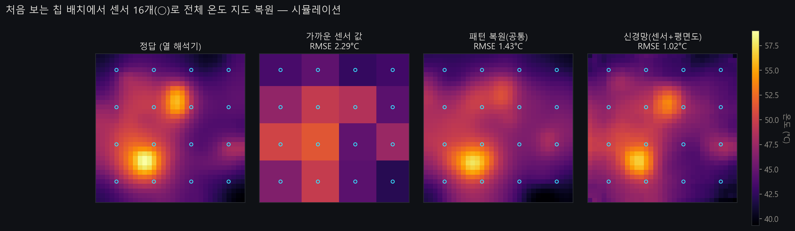

# thermal-chip-floorplan

열을 고려한 칩 블록 배치, 온도 센서 배치, 광학 스테이지 열 변형을 직접 만든 열 해석기로 시뮬레이션해 본 개인 프로젝트입니다.

> **모든 숫자는 가정 기반 시뮬레이션입니다.** 실제 칩·장비 측정값이 아닙니다. 가정값은 `docs/criteria.md`에 있습니다.


## 왜 하나
칩 설계에서 정확한 열 계산은 느려서 배치 중에 온도를 제대로 보기 어렵다. AI가 이를 빠르게 대신하면 설계 내내 열을 볼 수 있다.
업계가 이미 가는 방향(연구: ThermEDGe, DeepOHeat / 상용: Cadence Celsius Studio)을 **작게 직접 만들어 확인**하는 것이 목적이다.
"AI가 이긴다"를 미리 정하지 않고, 이기는지 지는지를 확인한다. (자세한 배경: `docs/plan.md`)

## 결과 요약
| 단계 | 내용 | 핵심 결과 (시뮬레이션) | 자세히 |
|---|---|---|---|
| 0 | 2D 정상상태 열 해석기 | 손계산 대비 최대 0.16% (1% 기준 통과), 1회 0.19 ms | `results/validation/` |
| 1 | 열을 고려한 칩 배치 (ami33, 33블록) | 온도 가중치 0.5: 같은 시드 10쌍 모두 더 시원, 평균 5.6°C↓, 배선 길이 +0.3% | `results/stage1_floorplan/stage1_result.md` |
| 1.5 | 온도 센서 배치·전체 지도 복원 | 데이터 기반 배치 + 패턴 복원: 센서 16개로 RMSE 0.49°C. 위치가 나쁘면 오차가 수백 배 증폭(조건수 1,580 vs 2.4) | `results/stage15_sensors/stage15_sensors_result.md` |
| 광학 | 광학 스테이지 열 변형 → 정렬 오차 | 열원 위치에 따라 광축 기울기 0~20.6 μrad, 거리 변화 25.5~28.8 μm는 배치로 없앨 수 없음(재료·온도 제어 문제) | `results/optical_stage/optical_stage_result.md` |
| 2 | 센서 복원 신경망 (처음 보는 칩 배치로 일반화) | 처음 보는 배치 50개: 신경망(센서+평면도) RMSE 0.86°C vs 패턴 복원 1.74°C. 평면도를 빼면 1.30°C. 같은 배치에선 패턴 복원이 같거나 더 나음(0.49 vs 0.57°C) | `results/stage2_nn/stage2_result.md` |

### 2단계: 처음 보는 칩 배치에서 센서 16개로 온도 지도 복원


## 폴더 구조
```
chipthermal/          공용 코드 (패키지)
  thermal.py          2D 정상상태 열 해석기 (유한체적), 직사각형 → 격자 면적비
  bookshelf.py        GSRC Bookshelf(.blocks/.nets/.pl) 읽기
  floorplan.py        시퀀스 페어 + 시뮬레이티드 어닐링 배치기 (배선 길이 + 온도)
  sensors.py          블록별 열 응답, 센서 배치(격자/뜨거운 블록/데이터 기반), 복원(가까운 값/패턴)
  optical.py          광학 스테이지 열 변형 → 광축 기울기·거리 변화
  nn.py               작은 U-Net (센서 → 온도 지도)
  paths.py            입출력 폴더
scripts/              실행 순서대로 번호
  00_validate_thermal.py      열 해석기 손계산 검증
  10_stage1_run.py            배선만 vs 배선+온도 (가중치 5 × 시드 3)
  11_stage1_robust.py         시드 10개 + 반복 4만 회 수렴 확인 (병렬)
  12_stage1_summary.py        시드 10개 요약 표·그림
  13_stage1_figures.py        1단계 비교 그림
  14_stage1_animation.py      배치 진화 애니메이션 (MP4)
  20_sensors_run.py           센서 실험
  21_sensors_figures.py       센서 그림
  30_optical_validate.py      광학 스테이지 손계산 검증
  31_optical_search.py        열원 배치 완전 탐색·센서 보정·그림
  40_stage2_floorplans.py     2단계용 합법 칩 배치 200개
  41_stage2_nn.py             센서 복원 신경망 학습·비교
  42_stage2_figures.py        2단계 그림
data/ami33/           MCNC ami33 벤치마크 (UMich VLSI CAD 배포본)
results/              단계별 결과 (그림, 표, json)
docs/                 plan.md, criteria.md(판단 기준·가정), data_check.md
```

## 실행
```bash
pip install -r requirements.txt
python scripts/00_validate_thermal.py
python scripts/10_stage1_run.py
```
프로젝트 루트에서 실행합니다. 각 스크립트는 `results/` 아래 자기 단계 폴더에 결과를 씁니다. 실행 로그는 `logs/`에 남습니다(저장소에는 안 올림).

## 한계
- 2D 단층 칩, 정상상태만. 실제 칩은 여러 층·시간 변화가 있음
- 블록 전력값, 냉각 조건, 재료 물성은 대표값 가정 (`docs/criteria.md`)
- 실제 회로 넷리스트·실측 데이터 없음. 손계산과 공개 벤치마크로만 검증
- 어닐링 반복 2만 회는 배선 길이 기준 완전 수렴이 아님 (4만 회에서 1~3% 더 줄어듦, 결론은 같음)

## 출처
- MCNC ami33: https://vlsicad.eecs.umich.edu/BK/MCNCbench/HARD/
- 계기가 된 논문: Karahan et al., *Deep-learning enabled generalized inverse design of multi-port radio-frequency and sub-terahertz passives and integrated circuits*, Nature Communications 15:10734 (2024)
