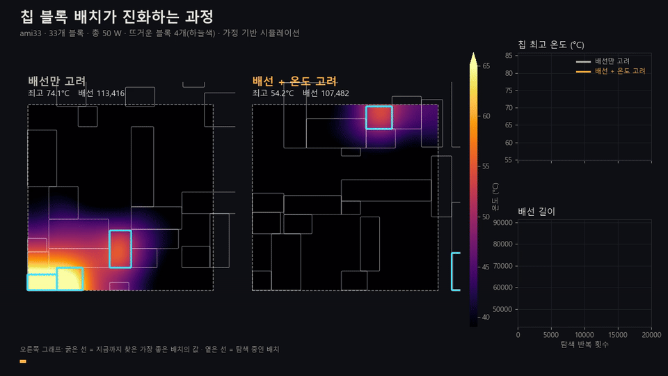
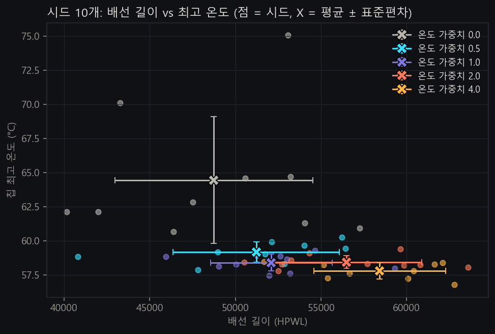
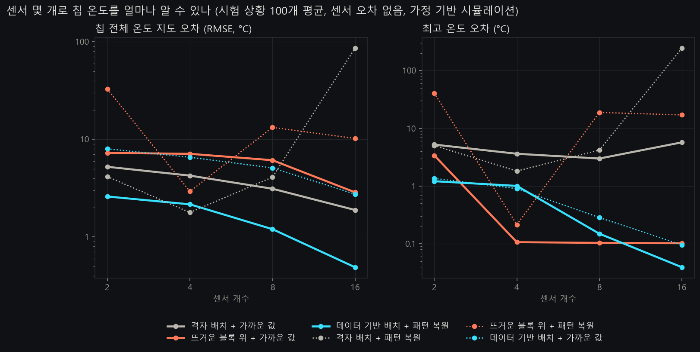
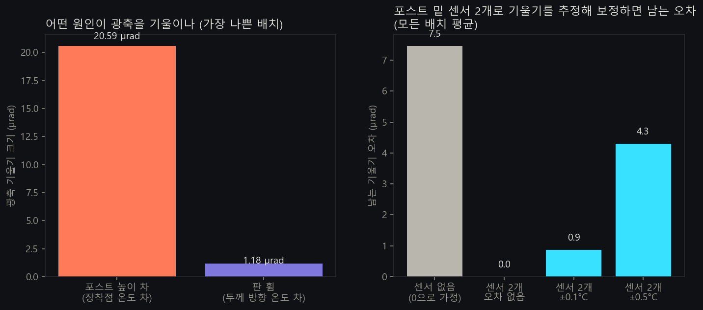

# Thermal-Aware Chip Floorplanning

직접 구현한 2D 열 해석기를 기반으로 **열을 고려한 칩 블록 배치**, **온도 센서 배치·온도 지도 복원**, **센서 복원 신경망**, **광학 스테이지 열 변형 해석**을 수행한 개인 프로젝트입니다.

> 본 저장소의 모든 수치는 가정 기반 **시뮬레이션** 결과이며, 실제 칩·장비의 측정값이 아닙니다. 가정값은 [`docs/criteria.md`](docs/criteria.md)에 정리되어 있습니다.

<p align="center">
  
</p>
<p align="center"><sub>배선 길이만 고려한 배치(왼쪽)와 배선+온도를 함께 고려한 배치(오른쪽)의 진화 과정</sub></p>

---

## 목차
1. [주요 결과](#1-주요-결과)
2. [배경 및 문제 정의](#2-배경-및-문제-정의)
3. [방법](#3-방법)
4. [단계별 결과](#4-단계별-결과)
5. [검증](#5-검증)
6. [저장소 구조](#6-저장소-구조)
7. [실행 방법](#7-실행-방법)
8. [한계](#8-한계)
9. [참고문헌](#9-참고문헌)

---

## 1. 주요 결과

| 단계 | 주제 | 결과 (시뮬레이션) |
|:---:|---|---|
| 0 | 2D 정상상태 열 해석기 | 해석해 대비 최대 오차 0.16%, 1회 해석 0.19 ms (32×32) |
| 1 | 열을 고려한 블록 배치 (MCNC ami33) | 온도 가중치 0.5에서 최고 온도 평균 **5.6°C 감소** (같은 시드 10쌍 모두 감소), 배선 길이 +0.3% |
| 1.5 | 온도 센서 배치·온도 지도 복원 | 데이터 기반 배치 + 패턴 복원으로 센서 16개 RMSE **0.49°C**. 센서 위치에 따라 조건수 2.4 vs 1,580 |
| 2 | 센서 복원 신경망 | 학습에 사용하지 않은 배치 50개에서 RMSE **0.86°C** (패턴 복원 1.74°C). 동일 배치에서는 패턴 복원이 동등 이상 |
| 부가 | 광학 스테이지 열 변형 | 열원 배치에 따라 광축 기울기 0~20.6 μrad. 장착점 간 거리 변화(25.5~28.8 μm)는 배치로 제거 불가 |

## 2. 배경 및 문제 정의

**배경.** 칩 블록 배치(floorplanning)에서는 배선 길이와 함께 발열 블록의 위치가 최고 온도를 좌우합니다. 정확한 열 해석은 배치 탐색 중 반복 수행하기에 비용이 크기 때문에, 연구(ThermEDGe, DeepOHeat)와 상용 도구(Cadence Celsius Studio) 모두 설계 단계에서 열을 빠르게 예측하는 방향으로 발전하고 있습니다.

**문제 정의.** 본 프로젝트는 이 흐름을 작은 규모로 직접 구현하여 다음 질문을 확인합니다.

1. 배치 탐색에 온도를 포함하면 배선 길이 손실 대비 최고 온도를 얼마나 낮출 수 있는가?
2. 소수의 온도 센서로 칩 전체 온도 지도를 복원할 때, 센서 위치와 복원 방법은 오차에 어떤 영향을 주는가?
3. 신경망은 기존 방법(보간, 패턴 복원)보다 나은가? 낫다면 어떤 조건에서인가?
4. 같은 열 해석 방법을 정밀 장비(광학 스테이지)의 정렬 오차 문제에 적용할 수 있는가?

신경망의 우위를 전제로 두지 않고, 기존 방법과 같은 조건에서 비교하여 확인하는 것을 원칙으로 했습니다.

## 3. 방법

| 구성 요소 | 내용 |
|---|---|
| **열 해석기** | 2D 정상상태 유한체적법. 지배방정식 `k·t·∇²T − h(T − T_amb) + q'' = 0`, 측면 단열. 희소 행렬 LU 분해를 한 번 수행한 뒤 재사용 |
| **배치기** | 시퀀스 페어(sequence pair) 표현 + 시뮬레이티드 어닐링. 비용 = 정규화 배선 길이(HPWL) + w × 정규화 최고 온도 상승 + 칩 경계 초과 벌점 |
| **센서 배치** | 격자 균등 / 고발열 블록 위 / 데이터 기반(주성분 상위 모드에 대한 열 피벗 QR 분해) |
| **온도 지도 복원** | 최근접 센서 값 / 주성분 기반 최소제곱(패턴 복원) / U-Net (센서 희소 지도 + 센서 위치 + 설계 전력 밀도 지도 입력) |
| **광학 스테이지** | 같은 해석기로 알루미늄 판 온도 계산 → 포스트 열팽창 차이로 광축 기울기, 경로 적분 `α∫ΔT ds`로 장착점 간 거리 변화 산출 |

열 모델이 선형이므로 블록별 1 W 응답을 한 번씩 계산해 두고, 임의의 전력 조건은 그 선형 결합으로 구했습니다.

## 4. 단계별 결과

각 단계의 상세 보고서는 해당 폴더의 `README.md`에 있습니다.

### 4.1 열을 고려한 블록 배치 → [상세](results/stage1_floorplan/)


- 온도 가중치 0.5: 최고 온도 64.24 ± 4.86°C → **58.62 ± 0.62°C**, 배선 길이 변화 +0.3%
- 온도를 고려하면 시드 간 편차도 크게 줄어듦 (표준편차 4.86 → 0.62°C)
- 가중치를 더 높이면 온도는 1°C 이내로만 더 내려가고 배선 길이는 최대 +26% 증가

### 4.2 온도 센서 배치·온도 지도 복원 → [상세](results/stage15_sensors/)


- 데이터 기반 배치 + 패턴 복원: 센서 8개 RMSE 1.20°C, 16개 0.49°C
- 격자 배치 + 패턴 복원은 센서 16개에서 RMSE 86°C로 실패. 원인은 센서 위치에 따른 조건수(1,580 vs 2.4)

### 4.3 센서 복원 신경망 → [상세](results/stage2_nn/)


| 방법 | 학습에 사용하지 않은 배치 RMSE | 최고 온도 오차 |
|---|:---:|:---:|
| 최근접 센서 값 | 2.24°C | 5.00°C |
| 패턴 복원 | 1.74°C | 2.11°C |
| 신경망 (센서만) | 1.30°C | 2.55°C |
| **신경망 (센서 + 설계 전력 밀도)** | **0.86°C** | **1.39°C** |

- 신경망의 우위는 설계 전력 밀도 입력에서 나옴. 이를 제외하면 최고 온도 오차는 패턴 복원보다 큼
- 배치가 고정된 경우에는 패턴 복원이 동등 이상 (센서 16개: 0.49 vs 0.57°C)

### 4.4 광학 스테이지 열 변형 → [상세](results/optical_stage/)


- 광축 기울기: 열원이 한쪽 장착점에 가까울 때 최대 20.6 μrad, 두 장착점의 대칭선 위에서 0
- 기울기의 주원인은 포스트 높이 차(20.6 μrad)이며 판 휨(1.18 μrad)은 작음
- 장착점 간 거리 변화는 모든 배치에서 25.5~28.8 μm → 배치가 아니라 재료·온도 제어로 다뤄야 할 항목
- 포스트 하단 센서 2개로 보정 시 평균 기울기 오차 7.5 → 0.9 μrad (센서 오차 ±0.1°C 기준)

## 5. 검증

| 대상 | 방법 | 결과 |
|---|---|---|
| 열 해석기 | 균일 발열(정확해), 1D 띠 발열(쌍곡선 함수 해석해), 에너지 보존 | 최대 상대 오차 0.16% (기준 1%) |
| 광학 스테이지 | 균일 가열 시 판 온도·거리 변화 손계산, 에너지 보존 | 상대 오차 1e-13 수준 |
| 배치 실험 | 초기 3개 시드 실험을 10개 시드 실험에서 재현 | 15/15 일치 |
| 코드 정리 후 재현 | 저장된 배치 15개 재계산, 센서·광학 실험 재실행 | 온도 차이 0, 결과 일치 |

검증 출력은 [`results/validation/`](results/validation/)에 있습니다.

## 6. 저장소 구조

```
chipthermal/                 공용 패키지
├── thermal.py               2D 정상상태 열 해석기, 직사각형 → 격자 면적비
├── bookshelf.py             GSRC Bookshelf(.blocks/.nets/.pl) 파서
├── floorplan.py             시퀀스 페어 + 시뮬레이티드 어닐링 배치기
├── sensors.py               블록별 열 응답, 센서 배치, 온도 지도 복원
├── nn.py                    U-Net (센서 → 온도 지도)
├── optical.py               광학 스테이지 열 변형 → 정렬 오차
└── paths.py                 입출력 경로
scripts/                     실행 순서대로 번호 부여
├── 00_validate_thermal.py   열 해석기 검증
├── 10~14_stage1_*.py        블록 배치 실험·요약·그림·애니메이션
├── 20~21_sensors_*.py       센서 배치 실험·그림
├── 30~31_optical_*.py       광학 스테이지 검증·탐색
└── 40~42_stage2_*.py        신경망용 배치 생성·학습·그림
data/ami33/                  MCNC ami33 벤치마크
results/                     단계별 결과 (각 폴더에 README.md)
docs/                        계획서(plan.md), 실험 조건·가정(criteria.md), 데이터·선행 조사(data_check.md)
```

## 7. 실행 방법

**환경**: Python 3.14, Windows, CPU only (GPU 불필요)

```bash
pip install -r requirements.txt
```

프로젝트 루트에서 실행하며, 각 스크립트는 `results/` 아래 해당 단계 폴더에 결과를 저장합니다.

| 단계 | 명령 (순서대로) |
|---|---|
| 열 해석기 검증 | `python scripts/00_validate_thermal.py` |
| 블록 배치 | `10_stage1_run.py` → `11_stage1_robust.py` → `12_stage1_summary.py` → `13_stage1_figures.py` |
| 애니메이션 | `14_stage1_animation.py` (ffmpeg 필요) |
| 센서 배치 | `20_sensors_run.py` → `21_sensors_figures.py` |
| 광학 스테이지 | `30_optical_validate.py` → `31_optical_search.py` |
| 센서 복원 신경망 | `40_stage2_floorplans.py` → `41_stage2_nn.py` → `42_stage2_figures.py` |

## 8. 한계

- 단층 2D 정상상태 모델이며, 다층 구조와 시간에 따른 온도 변화는 다루지 않음
- 블록 전력, 냉각 조건, 재료 물성은 대표값 가정 (실제 회로 전력 정보 없음)
- 검증은 해석해·손계산 기준이며, 상용 열해석 도구나 실측과는 비교하지 않음
- 어닐링 2만 회는 배선 길이 기준으로 완전히 수렴하지 않음 (4만 회에서 1~3% 추가 감소, 결론은 동일)
- 신경망은 같은 ami33 블록 구성의 다른 배치에서만 시험했으며, 블록 구성이 다른 칩으로의 일반화는 확인하지 않음

## 9. 참고문헌

- MCNC ami33 benchmark, UMich VLSI CAD: https://vlsicad.eecs.umich.edu/BK/MCNCbench/HARD/
- Karahan et al., "Deep-learning enabled generalized inverse design of multi-port radio-frequency and sub-terahertz passives and integrated circuits," *Nature Communications* 15, 10734 (2024)
- ThermEDGe, DeepOHeat, Cadence Celsius Studio, EigenMaps 등 관련 연구 출처: [`docs/data_check.md`](docs/data_check.md)
