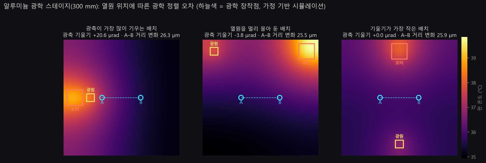
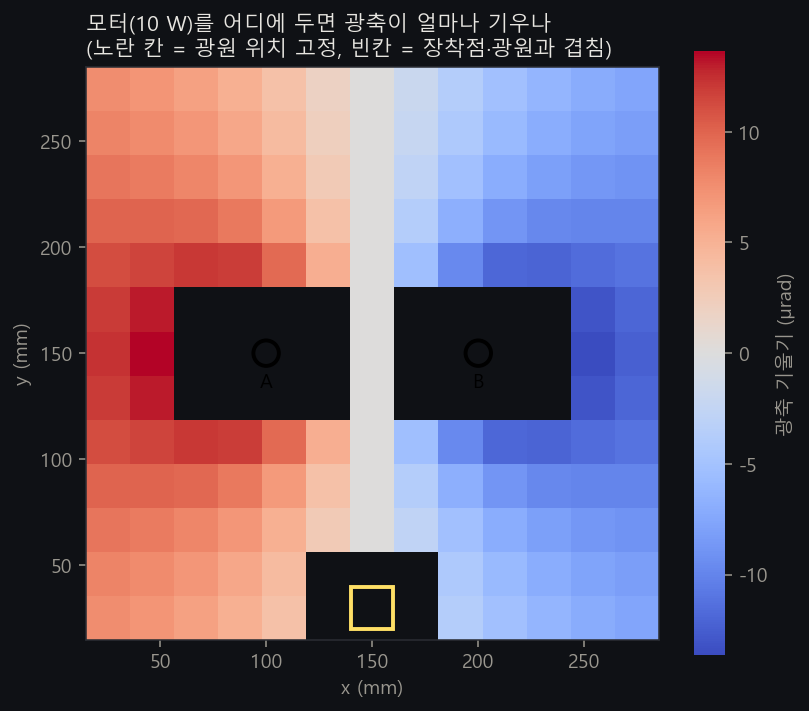
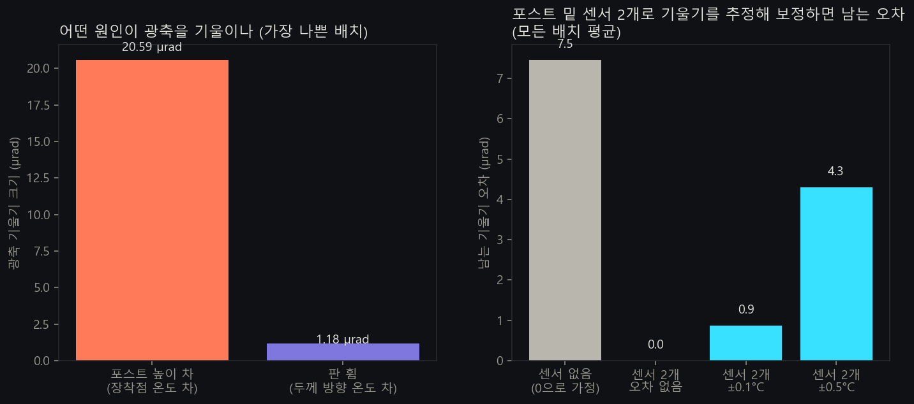

# 부가 모듈. 광학 스테이지 열 변형과 정렬 오차

> 모든 수치는 가정 기반 시뮬레이션입니다. 가정값: [`docs/criteria.md`](../../docs/criteria.md) #26~33

## 1. 목적
칩 열 해석에 쓴 방법을 가정한 광학 스테이지 모델에 적용하여, 스테이지 위 열원(광원·모터)의 배치가 광학 정렬 오차(광축 기울기, 장착점 간 거리 변화)에 미치는 영향을 분석한다. 배치로 줄일 수 있는 오차와 그렇지 않은 오차를 구분하는 것이 목표다.

**모델의 성격**: 판의 온도 분포는 열 해석기로 계산하고, 변형은 단순 근사식(포스트 열팽창, 선 적분, 판 휨 공식)으로 추정한다. 구조 해석(유한요소)이 아니다.

## 2. 실험 설정

| 항목 | 값 |
|---|---|
| 스테이지 | 알루미늄 6061 판 300 × 300 × 12.7 mm, k = 167 W/m·K, α = 23.6 × 10⁻⁶ /K |
| 냉각 | 상·하면 자연대류 등가 h = 15 W/m²·K, 측면 단열, 주변 25°C |
| 열원 | 광원 5 W (20 × 20 mm), 모터 10 W (40 × 40 mm) |
| 광학 장착 | 장착점 A (100, 150 mm), B (200, 150 mm), 간격 100 mm. 스테인리스 포스트 높이 75 mm, α = 17.3 × 10⁻⁶ /K |
| 격자 | 60 × 60 |
| 탐색 | 광원·모터 위치 조합 21,636가지 전수 탐색 (열원 겹침 제외) |

**정렬 오차 지표**

| 지표 | 계산 |
|---|---|
| 광축 기울기 | θ = α_post · L · (T_A − T_B) / d |
| 장착점 간 거리 변화 | Δd = α_Al ∫ ΔT ds (A–B 선을 따라) |
| 판 휨에 의한 기울기 | κ = α_Al · ΔT_z / t (크기 비교용) |

## 3. 결과

### 3.1 배치별 정렬 오차

| 배치 | 광축 기울기 | A–B 거리 변화 |
|---|:---:|:---:|
| 최악 (열원이 장착점 A에 인접) | +20.6 μrad | 26.3 μm |
| 열원을 먼 모서리로 배치 | −3.8 μrad | 25.5 μm |
| 기울기 최소 (A–B 대칭선 위) | 0.0 μrad | 25.9 μm |
| 전체 배치 평균 (절댓값) | 7.5 μrad | — |
| 탐색한 전체 배치의 범위 | 0 ~ 20.6 μrad | 25.5 ~ 28.8 μm |





### 3.2 기울기 원인 분해와 센서 보정

| 항목 | 값 |
|---|:---:|
| 최악 배치에서 포스트 높이 차에 의한 기울기 | 20.6 μrad |
| 최악 배치에서 판 휨에 의한 기울기 | 1.18 μrad |
| 보정 없음, 평균 기울기 오차 | 7.5 μrad |
| 포스트 하단 센서 2개로 보정 (센서 오차 ±0.1°C) | 평균 0.9 μrad (최대 2.6) |
| 포스트 하단 센서 2개로 보정 (센서 오차 ±0.5°C) | 평균 4.3 μrad (최대 12.8) |



## 4. 해석
1. **이 모델에서 기울기는 배치로 없앨 수 있다.** 열원을 두 장착점에서 같은 거리, 즉 A–B 대칭선(x = 150 mm) 위에 두면 기울기가 0이 된다. 탐색이 대칭 원리를 다시 찾아냈으며, 대칭에서 벗어날 때의 손실(최대 20.6 μrad)을 수치로 얻었다.
2. **열원을 멀리 두는 것만으로는 부족하다.** 먼 모서리에 배치해도 −3.8 μrad가 남는다. 거리보다 대칭이 중요하다.
3. **거리 변화는 탐색한 배치 범위에서 크게 줄지 않았다.** 25.5~28.8 μm로, 배치로 줄일 수 있는 폭은 약 3 μm였다. 총 발열량과 알루미늄 열팽창의 영향이 커서, 이 모델에서는 저열팽창 재료나 온도 제어가 더 효과적인 수단으로 보인다.
4. **이 가정에서 기울기의 주원인은 포스트 높이 차였다.** 판 휨에 의한 기울기(근사식)보다 약 17배 크다.
5. **센서 보정의 효과는 센서 정확도에 좌우된다.** 모델 안에서 ±0.1°C 센서는 오차를 7.5 → 0.9 μrad로 줄이지만, ±0.5°C에서는 4.3 μrad에 그친다.

## 5. 한계
- 정상상태만 다룬다. 열원 가동 직후 온도가 변하는 동안의 정렬 변화는 포함하지 않았다.
- 포스트 하단 온도를 해당 위치의 판 온도로 가정했고, 포스트 내부 온도 분포와 접촉 열저항은 무시했다.
- 거리 변화는 A–B 선을 따른 1D 적분 근사이며, 판 전체의 평면 응력 해석이 아니다.
- 진동과 체결(볼트) 효과는 다루지 않았다.
- 판 휨은 두께 방향 온도차에 대한 근사식이며, 포스트 기울기·판 휨 모두 독립적인 구조 해석으로 검증하지 않았다.
- 센서 보정 결과는 모델이 계산한 온도에 균등분포 센서 오차만 더한 값이다. 센서 응답 지연, 접촉 오차, 모델 자체의 오차는 포함하지 않았다.

## 6. 검증과 재현

| 검증 항목 | 결과 |
|---|---|
| 균일 가열: 판 온도 상승 11.111 K, 거리 변화 26.222 μm, 기울기 0 | 손계산과 일치 (상대 오차 1e-13 수준) |
| 에너지 보존 (10 W 입력) | 일치 |
| 포스트 기울기·판 휨 식 | 같은 식의 이중 계산으로 코드 일관성만 확인 (독립 검증 아님) |

```bash
python scripts/30_optical_validate.py   # 손계산 검증
python scripts/31_optical_search.py     # 전수 탐색, 센서 보정, 그림
```

| 파일 | 내용 |
|---|---|
| `optical_results.json` | 탐색 요약, 대표 배치, 센서 보정 결과 |
| `fig_o1_layouts.png`, `fig_o2_motor_tilt_map.png`, `fig_o3_mechanism_sensor.png` | 그림 |
| [`../validation/validate_optical_stage_output.txt`](../validation/validate_optical_stage_output.txt) | 검증 출력 |
