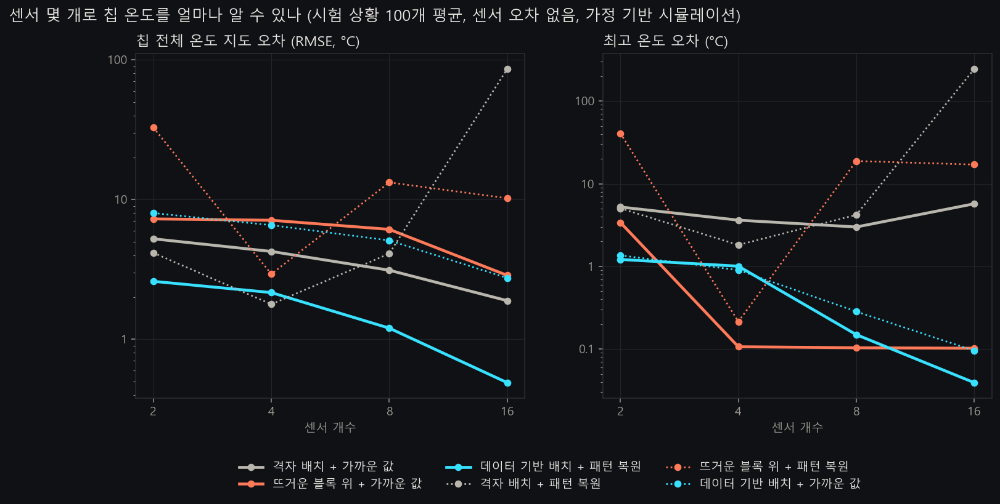
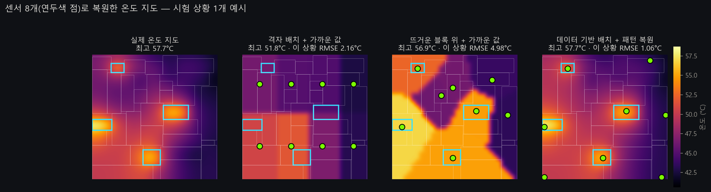
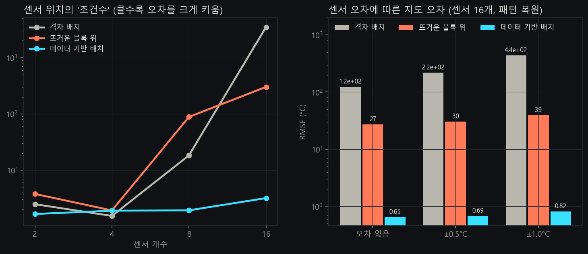

# Stage 1.5. 온도 센서 배치와 온도 지도 복원

> 모든 수치는 가정 기반 시뮬레이션입니다. 가정값: [`docs/criteria.md`](../../docs/criteria.md) #13~18

## 1. 목적
소수의 온도 센서로 칩 전체 온도 지도를 복원할 때, 센서 배치 방법과 복원 방법이 오차에 미치는 영향을 비교한다.

## 2. 실험 설정

| 항목 | 값 |
|---|---|
| 칩 배치 | Stage 1의 온도 고려 최종 배치 (w = 1.0, 시드 0) |
| 동작 조건 | 블록별 전력 × U(0.2, 1.5) 무작위, 500개 (학습 400 / 시험 100) |
| 시험 조건 최고 온도 | 평균 57.2°C (범위 47.2~63.7°C) |
| 센서 개수 | 2, 4, 8, 16 |
| 센서 배치 | 격자 균등 / 고발열 블록 위 / 데이터 기반 (주성분 상위 k개 모드에 열 피벗 QR 분해) |
| 복원 방법 | 최근접 센서 값 / 주성분 기반 최소제곱 (패턴 복원) |
| 센서 오차 | 없음, ±0.5°C, ±1°C (균등분포) |
| 평가 지표 | 지도 전체 RMSE, 최고 온도 오차 \|T_max − T̂_max\| (시험 100개 평균) |

## 3. 결과

### 3.1 센서 개수별 오차 (센서 오차 없음, RMSE / 최고 온도 오차, °C)

| 센서 | 격자 + 최근접 | 고발열 블록 위 + 최근접 | 데이터 기반 + 패턴 복원 |
|:---:|:---:|:---:|:---:|
| 2 | 5.23 / 5.22 | 7.27 / 3.39 | **2.60 / 1.21** |
| 4 | 4.25 / 3.62 | 7.11 / **0.11** | **2.16** / 1.01 |
| 8 | 3.12 / 3.00 | 6.12 / **0.10** | **1.20 / 0.15** |
| 16 | 1.89 / 5.72 | 2.87 / 0.10 | **0.49 / 0.04** |





### 3.2 센서 위치와 오차 증폭

| 조건 (센서 16개, 패턴 복원) | 조건수 | RMSE (오차 없음) | RMSE (센서 오차 ±1°C) |
|---|:---:|:---:|:---:|
| 데이터 기반 배치 | 2.4 | 0.49°C | 0.67°C |
| 격자 배치 | 1,580 | 86°C | 217°C |



## 4. 해석
1. **칩 전체 지도는 데이터 기반 배치 + 패턴 복원이 가장 정확하다.** 센서 8개로 RMSE 1.20°C, 16개로 0.49°C이며, 센서 오차 ±1°C에서도 16개 기준 0.67°C를 유지한다.
2. **고발열 블록 위 배치는 최고 온도만 정확하다.** 최고 온도 오차는 약 0.1°C지만 나머지 영역을 복원하지 못해 RMSE가 6~7°C이다. 어떤 블록이 뜨거운지 미리 안다는 가정이 포함되어 있다.
3. **센서 위치가 나쁘면 정교한 복원 방법이 오히려 실패한다.** 격자 16개 + 패턴 복원은 조건수 1,580으로, 작은 측정 오차가 결과에서 크게 증폭된다. 측정 오차의 영향은 센서 정확도뿐 아니라 계산 구조(센서 위치)에 따라 결정된다.
4. 데이터 기반 배치는 센서를 칩 가장자리·모서리에도 두는데, 이는 직관적인 배치와 다르다.

## 5. 한계
- 동작 조건이 블록별 무작위 배수로, 실제 작업 부하 패턴과 다르다.
- 센서 오차는 균등분포, 센서 위치는 격자 칸 중심으로 근사했다.
- 학습과 시험이 같은 배치에서 나왔다. 다른 배치로의 일반화는 Stage 2에서 다룬다.

## 6. 재현

```bash
python scripts/20_sensors_run.py
python scripts/21_sensors_figures.py
```

| 파일 | 내용 |
|---|---|
| `sensors_results.json` | 모든 조건의 RMSE·최고 온도 오차 |
| `sensors_condition_numbers.json` | 배치별 조건수 |
| `sensors_output.txt` | 실행 출력 |
| `fig_s1_error_vs_k.png`, `fig_s2_maps_k8.png`, `fig_s3_conditioning.png` | 그림 |
