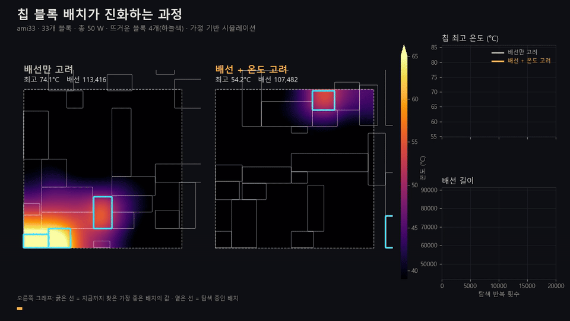

# Stage 1. 배치 진화 애니메이션

> 가정 기반 시뮬레이션입니다.

시뮬레이티드 어닐링(20,000회 반복) 중 200회마다 기록한 배치를 이어 붙인 애니메이션입니다.

| 왼쪽 | 오른쪽 |
|---|---|
| 배선 길이만 고려 (w = 0, 시드 0) | 배선 + 온도 고려 (w = 1, 시드 0) |

| 파일 | 내용 |
|---|---|
| `anim_compare.mp4`, `anim_compare.gif` | 애니메이션 |
| `anim_compare_final.png` | 마지막 프레임 |
| `anim_frame_025.png`, `anim_frame_050.png` | 중간 프레임 |

재현: `python scripts/14_stage1_animation.py` (ffmpeg 필요)
