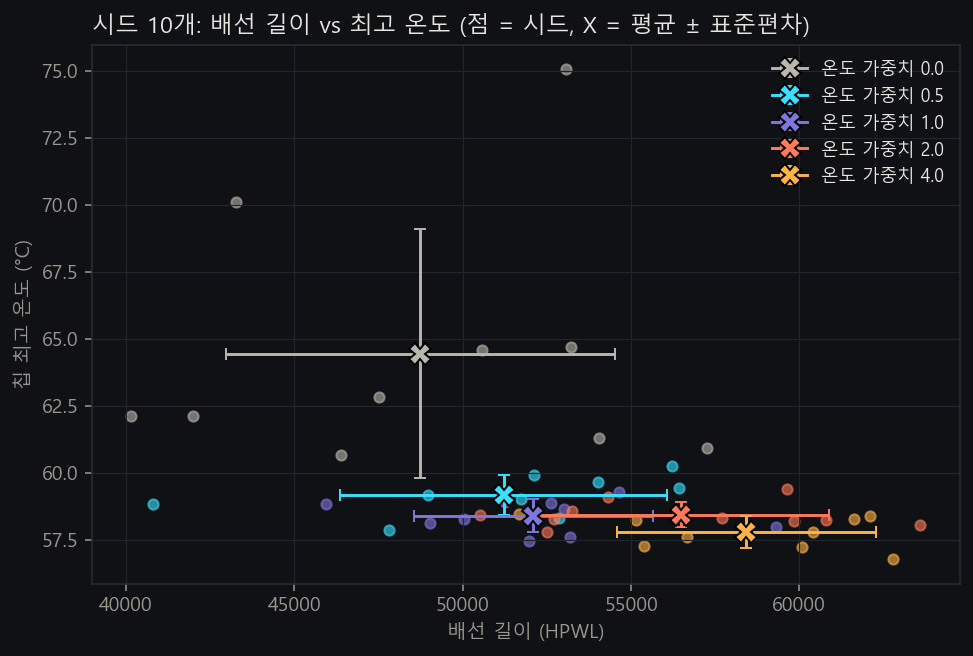
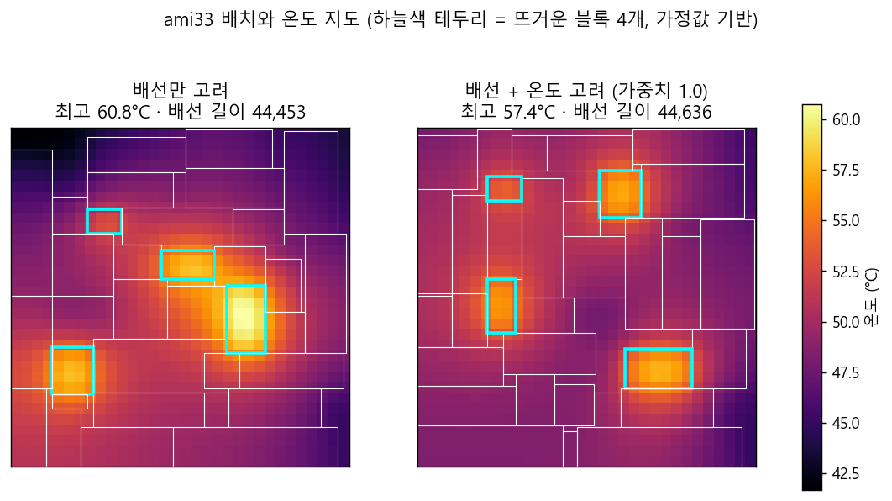

# Stage 1. 열을 고려한 블록 배치

> 모든 수치는 가정 기반 시뮬레이션입니다. 가정값: [`docs/criteria.md`](../../docs/criteria.md) #1~12

## 1. 목적
배치 탐색의 비용 함수에 최고 온도를 추가했을 때, 배선 길이 손실 대비 최고 온도를 얼마나 낮출 수 있는지 확인한다.

## 2. 실험 설정

| 항목 | 값 |
|---|---|
| 벤치마크 | MCNC ami33 (블록 33개, 넷 123개 중 전원 넷 2개 제외, 외부 단자 미사용) |
| 칩 | 10 mm × 10 mm, 빈 공간 15% (칩 면적 = 블록 면적 합 × 1.15) |
| 전력 | 총 50 W, 면적 비례 + 고발열 블록 4개(bk10b, bk19, bk5c, bk7)는 전력 밀도 5배 |
| 열 모델 | 32×32 격자, 실리콘 k = 150 W/m·K, 두께 0.5 mm, 하부 h = 20,000 W/m²·K, 주변 25°C |
| 배치기 | 시퀀스 페어 + 시뮬레이티드 어닐링, 반복 20,000회, 칩 경계 초과 벌점 50 |
| 비용 함수 | HPWL / HPWL₀ + w · ΔT_max / ΔT₀ + 벌점 · 초과 면적 |
| 비교 | 온도 가중치 w ∈ {0, 0.5, 1, 2, 4}, 시드 10개 (같은 시드끼리 짝 비교) |

## 3. 결과

### 3.1 시드 10개 요약

| 온도 가중치 | 합법 배치 | 배선 길이 (평균 ± 표준편차) | 최고 온도 (평균 ± 표준편차) |
|:---:|:---:|---:|---:|
| 0 (배선만) | 10/10 | 48,353 ± 3,862 | 64.24 ± 4.86°C |
| **0.5** | 10/10 | **48,226 ± 4,392** | **58.62 ± 0.62°C** |
| 1.0 | 9/10 | 52,183 ± 4,903 | 58.12 ± 0.50°C |
| 2.0 | 8/10 | 56,615 ± 3,819 | 57.97 ± 0.79°C |
| 4.0 | 9/10 | 60,953 ± 6,051 | 57.68 ± 0.54°C |

### 3.2 같은 시드끼리 비교 (가중치 0 대비)

| 가중치 | 짝 수 | 최고 온도 감소 | 온도가 낮아진 짝 | 배선 길이 변화 |
|:---:|:---:|:---:|:---:|:---:|
| 0.5 | 10 | 5.62 ± 4.99°C | 10/10 | +0.3% |
| 1.0 | 9 | 6.34 ± 5.10°C | 9/9 | +8.2% |





### 3.3 수렴 확인 (시드 5개)

| 가중치 | 반복 | 최고 온도 평균 | 배선 길이 평균 |
|:---:|---:|---:|---:|
| 0 | 20,000 | 63.53°C | 47,294 |
| 0 | 40,000 | 65.55°C | 46,647 |
| 0.5 | 20,000 | 58.71°C | 46,606 |
| 0.5 | 40,000 | 58.18°C | 45,179 |

## 4. 해석
1. **작은 가중치로 대부분의 효과를 얻는다.** w = 0.5에서 배선 길이는 사실상 그대로(+0.3%)이면서 최고 온도가 평균 5.6°C 낮아졌다. 가중치를 더 높여도 온도는 1°C 이내로만 더 내려가고 배선 길이는 최대 +26% 늘어난다.
2. **결과가 안정된다.** 배선만 고려하면 고발열 블록이 우연히 모이느냐에 따라 최고 온도가 크게 흔들리지만(표준편차 4.86°C), 온도를 고려하면 0.62°C로 줄어든다.
3. **배치 양상.** 온도를 고려하면 고발열 블록 4개가 서로 떨어져 배치된다(그림 1). 같은 전력을 칩 전체에 균일하게 분포시켰을 때의 이론 하한은 50°C(온도 상승 25 K)로, 고발열 블록이 존재하는 한 이보다 낮아질 수 없다.

## 5. 한계
- 반복 20,000회는 배선 길이 기준으로 완전히 수렴하지 않았다(40,000회에서 1~3% 추가 감소). 온도 감소 결론은 같다.
- 가중치가 높을수록 칩 경계를 넘는 불합격 배치가 생긴다(w = 2.0에서 2/10).
- 블록 전력은 가정값이며 실제 회로 정보가 아니다.

## 6. 재현

```bash
python scripts/10_stage1_run.py       # 가중치 5개 × 시드 3개 (초기 실험)
python scripts/11_stage1_robust.py    # 시드 10개 + 40,000회 수렴 확인 (병렬)
python scripts/12_stage1_summary.py   # 요약 표
python scripts/13_stage1_figures.py   # 그림
python scripts/14_stage1_animation.py # 배치 진화 애니메이션 (ffmpeg 필요)
```

| 파일 | 내용 |
|---|---|
| `stage1_runs.json`, `stage1_layouts.npz` | 초기 실험 결과와 최종 배치·온도 지도 |
| `stage1_robust.jsonl`, `stage1_robust_summary.md` | 시드 10개·수렴 확인 결과 |
| `stage1_summary.md` | 초기 실험(시드 3개) 요약 표 |
| `fig1_compare.png`, `fig2_tradeoff.png`, `fig3_tradeoff_10seeds.png` | 그림 |
| [`../stage1_animation/`](../stage1_animation/) | 배치 진화 애니메이션 (w = 0 시드 2 vs w = 1 시드 0) |
