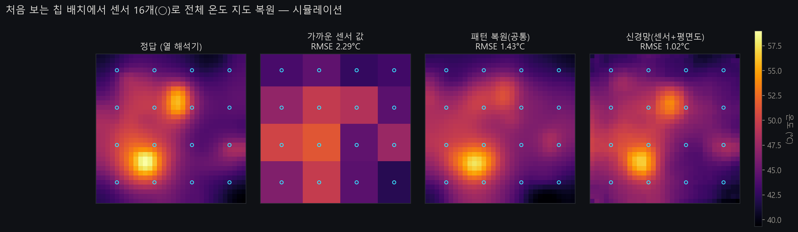
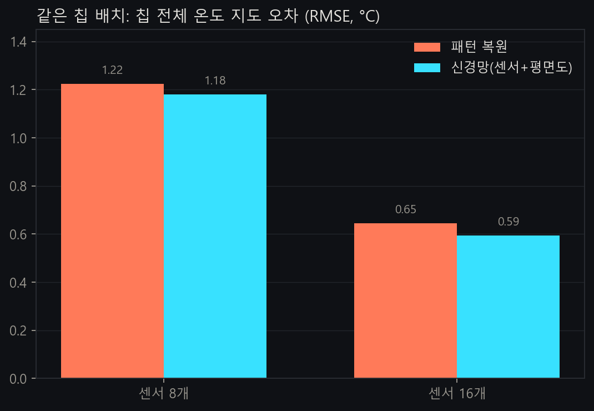

# Stage 2. 센서 복원 신경망

> 모든 수치는 가정 기반 시뮬레이션입니다. 가정값: [`docs/criteria.md`](../../docs/criteria.md) #19~25

## 1. 목적
소수의 센서로 칩 전체 온도 지도를 복원할 때 신경망이 기존 방법(최근접 센서 값, 패턴 복원)보다 나은지, 낫다면 어떤 조건에서인지 확인한다.

32×32 열 해석은 1회 0.19 ms로 이미 빠르기 때문에, 이 규모에서 "느린 해석을 신경망이 대체한다"는 의미가 없다. 따라서 **학습에 사용하지 않은 배치에서의 일반화**를 핵심 질문으로 둔다.

## 2. 실험 설정

| 항목 | 실험 A: 처음 보는 배치 (핵심) | 실험 B: 동일 배치 |
|---|---|---|
| 칩 배치 | ami33 합법 배치 200개. 0~149번은 3개 출발점, 150~199번은 별도 4번째 출발점에서 생성 | Stage 1.5와 동일 배치 1개 |
| 데이터 분할 | 학습 135 / 검증 15 / 시험 50 배치 (시험 = 150~199번) × 동작 조건 50개 | 동작 조건 학습 360 / 검증 40 / 시험 100 |
| 센서 | 4 × 4 격자 16개 고정 | 데이터 기반 8개, 16개 |
| 비교 방법 | 최근접 센서 값, 패턴 복원(학습 배치 공통, 패턴 수 12개를 검증으로 선택), 신경망(센서만), 신경망(센서 + 설계 전력 밀도) | 패턴 복원, 신경망(센서 + 설계 전력 밀도) |
| 학습 | 20 에폭, 배치 64 | 300 에폭, 배치 32 |

**신경망**: U-Net (채널 16-32-64), AdamW + OneCycle 학습률, CPU 학습. 입력은 센서 희소 지도, 센서 위치 마스크, 설계 전력 밀도 지도(선택). 학습 중 센서 오차 0~±1°C를 무작위로 추가했다.

## 3. 결과

### 3.1 실험 A: 처음 보는 배치 (시험 2,500개 지도)

| 방법 | RMSE (센서 오차 0 / ±0.5 / ±1°C) | 최고 온도 오차 (0 / ±1°C) |
|---|:---:|:---:|
| 최근접 센서 값 | 2.24 / 2.26 / 2.32°C | 5.00 / 4.98°C |
| 패턴 복원 | 1.74 / 1.77 / 1.83°C | 2.11 / 2.16°C |
| 신경망 (센서만) | 1.30 / 1.32 / 1.40°C | 2.55 / 2.62°C |
| **신경망 (센서 + 설계 전력 밀도)** | **0.86 / 0.89 / 0.97°C** | **1.39 / 1.45°C** |




### 3.2 실험 B: 동일 배치 (센서 오차 없음)

| 센서 | 패턴 복원 RMSE | 신경망 RMSE | 패턴 복원 최고 온도 오차 | 신경망 최고 온도 오차 |
|:---:|:---:|:---:|:---:|:---:|
| 8개 | 1.20°C | 1.15°C | **0.15°C** | 0.37°C |
| 16개 | **0.49°C** | 0.57°C | **0.04°C** | 0.33°C |



## 4. 해석
1. **처음 보는 배치에서는 신경망(센서 + 설계 전력 밀도)이 가장 정확하다.** RMSE가 패턴 복원의 약 절반(0.86 vs 1.74°C)이고, 최고 온도 오차도 2.11 → 1.39°C로 줄었다. 센서 오차 ±1°C에서도 순위가 유지된다.
2. **우위의 원천은 설계 전력 밀도 입력이다.** 같은 신경망에 센서 값만 넣으면 RMSE 1.30°C이고, 최고 온도 오차는 패턴 복원보다 크다(2.55 vs 2.11°C). 신경망 구조 자체보다 "열원이 어디에 있는지"에 대한 정보가 차이를 만든다.
3. **배치가 고정되면 신경망의 이점이 없다.** 패턴 복원이 별도 학습 없이 동등하거나 더 정확하며, 특히 최고 온도 오차에서 우수하다. 배치가 하나로 고정되면 온도 분포가 소수의 패턴으로 설명되기 때문이다.
4. 신경망의 실용적 가치는 계산 속도가 아니라 **배치가 바뀌어도 재구성 없이 복원할 수 있다는 점**에 있다.

## 5. 한계
- 초기 설계(채널 32-64-128, 40 에폭)는 CPU에서 1시간 이상 소요되어 모델과 에폭을 축소했다. 실험 A의 검증 오차는 마지막 5 에폭 동안 0.917 → 0.887°C로 거의 수렴했다.
- 실험 B의 신경망은 60 에폭에서 검증 오차가 계속 감소하여(2.46°C) 300 에폭으로 재학습했다(0.57°C).
- 처음 보는 배치는 같은 ami33 블록 구성의 다른 배치다. 블록 구성이 다른 칩은 시험하지 않았다.
- 패턴 복원은 패턴 16개에서 검증 오차가 12.3°C로 급증하여 12개를 사용했다(Stage 1.5의 조건수 문제와 같은 현상).

## 6. 재현

```bash
python scripts/40_stage2_floorplans.py    # 합법 배치 200개 생성
python scripts/41_stage2_nn.py            # 실험 A + B
python scripts/41_stage2_nn.py --same-only  # 실험 B만 재실행 (A 결과 유지)
python scripts/42_stage2_figures.py       # 그림
```

| 파일 | 내용 |
|---|---|
| `stage2_floorplans.npz` | 배치 200개 (블록 좌표·크기, 출발점 번호) |
| `stage2_results.json` | 모든 방법·조건의 RMSE·최고 온도 오차, 예시 지도 |
| `stage2_nn_floorplan.pt` | 학습된 신경망 (센서 + 설계 전력 밀도) |
| `fig_n1_example_unseen.png`, `fig_n2_unseen_bars.png`, `fig_n3_same_floorplan.png` | 그림 |
