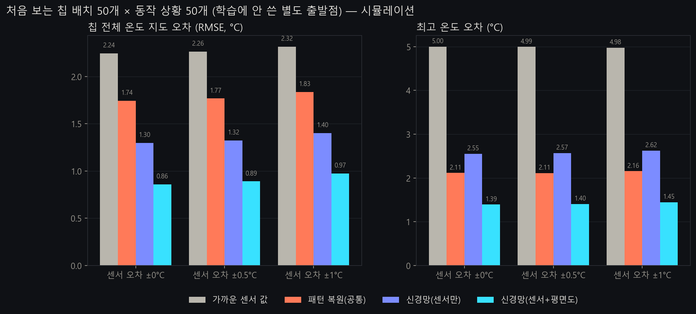
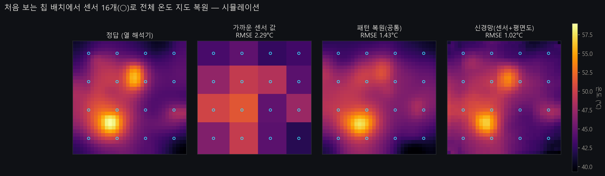
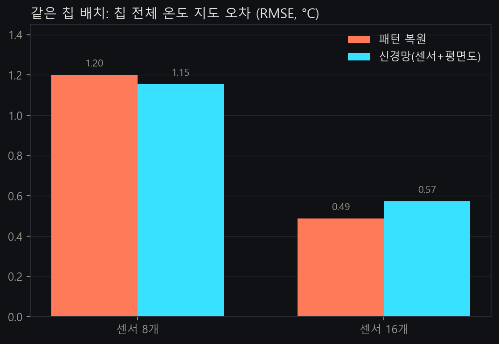

# 2단계 결과: 센서 복원 신경망 (2026-11-16)

> 모든 숫자는 가정 기반 **시뮬레이션**입니다. 조건은 `docs/criteria.md` #19~25.

## 질문
센서 몇 개의 값으로 칩 전체 온도 지도를 복원할 때, 신경망이 단순한 방법(가까운 센서 값, 패턴 복원)보다 나은가?
1.5단계에서 이미 알았듯 32×32 열 해석은 1회 0.19 ms라 "느린 계산을 AI가 대신한다"는 이 규모에서 의미가 없다.
그래서 2단계는 **처음 보는 칩 배치에서도 복원이 되는가(일반화)** 를 본다.

## 설정
- 칩 배치: ami33(33블록)의 합법 배치 200개. 0~149번은 출발점 3개에서, 150~199번은 **학습에 안 쓴 4번째 출발점**에서 만듦
  - 학습 135개 / 검증 15개 / 시험 50개(150~199번) × 동작 상황(블록별 전력 0.2~1.5배 무작위) 50개
- 센서: 4×4 격자 16개 고정 (처음 보는 배치에서는 데이터 기반 배치를 미리 정할 수 없으므로)
- 신경망: 작은 U-Net(채널 16-32-64), CPU 학습. 입력 = 센서 값 희소 지도 + 센서 위치 + (선택) 평면도의 설계 전력 밀도 지도
  - 학습 중 센서 오차 0~±1°C를 무작위로 넣음
- 비교: 가까운 센서 값 / 패턴 복원(학습 배치 전체로 만든 공통 패턴, 패턴 수는 검증 데이터로 골라 12개) / 신경망(센서만) / 신경망(센서+평면도)

## 결과 ① 처음 보는 칩 배치 (핵심)
시험 50개 배치 × 50개 상황 = 2,500개 지도, 센서 16개

| 방법 | 지도 오차 RMSE (센서 오차 0 / ±0.5 / ±1°C) | 최고 온도 오차 (0 / ±1°C) |
|---|---|---|
| 가까운 센서 값 | 2.24 / 2.26 / 2.32°C | 5.00 / 4.98°C |
| 패턴 복원(공통) | 1.74 / 1.77 / 1.83°C | 2.11 / 2.16°C |
| 신경망(센서만) | 1.30 / 1.32 / 1.40°C | 2.55 / 2.62°C |
| **신경망(센서+평면도)** | **0.86 / 0.89 / 0.97°C** | **1.39 / 1.45°C** |

## 결과 ② 같은 칩 배치 (1.5단계 설정 그대로)
배치 1개, 학습 360 / 검증 40 / 시험 100개 상황, 데이터 기반 센서 배치

| 센서 | 패턴 복원 RMSE | 신경망 RMSE | 패턴 복원 최고 온도 오차 | 신경망 최고 온도 오차 |
|---|---|---|---|---|
| 8개 | 1.20°C | 1.15°C | 0.15°C | 0.37°C |
| 16개 | **0.49°C** | 0.57°C | **0.04°C** | 0.33°C |

## 알게 된 것
1. **처음 보는 칩 배치에서는 신경망(센서+평면도)이 가장 좋음.** 지도 오차가 공통 패턴 복원의 약 절반(0.86 vs 1.74°C), 최고 온도 오차도 2.11 → 1.39°C. 센서 오차 ±1°C에서도 순서가 그대로.
2. **이기는 이유는 평면도 정보.** 같은 신경망에 센서만 넣으면 1.30°C이고 최고 온도 오차는 패턴 복원보다 오히려 나쁨(2.55 vs 2.11). "신경망이라서"가 아니라 "어디에 열원이 있는지 아는 입력"이 차이를 만든다.
3. **같은 칩 배치에서는 신경망이 이기지 못함.** 패턴 복원이 학습도 거의 필요 없이 비슷하거나 더 정확(특히 최고 온도). 배치가 하나로 고정되면 온도 패턴이 몇 개로 정리되기 때문.
4. 결론: AI의 쓸모는 "계산이 빨라서"가 아니라 **배치가 바뀌어도 다시 만들 필요 없이 복원이 된다**는 점. 업계 방향(설계 정보를 함께 쓰는 열 예측)과 같은 결론을 작게 확인.

## 한계·진행 중 바꾼 것
- 처음 계획한 크기(채널 32-64-128)는 CPU에서 전체 1시간 이상이라, 채널을 절반으로 줄이고 반복을 40 → 20회로 줄임(처음 보는 배치). 같은 배치 신경망은 60회에서 아직 오차가 줄고 있어 300회로 다시 학습함(검증 오차 2.46 → 0.57).
- 처음 보는 배치 신경망은 마지막 5회 동안 검증 오차가 0.917 → 0.887로 거의 멈춤. 원래 크기·반복으로 하면 달라질 수 있지만 확인하지 않음.
- 처음 보는 배치는 같은 ami33 블록의 다른 배치. 블록 구성이 다른 칩은 시험하지 않음.
- 패턴 복원은 패턴 16개에서 오차가 12.3°C로 급증(검증) — 1.5단계의 "센서 위치가 나쁘면 오차 증폭"과 같은 현상. 그래서 12개 사용.
- 실행: `python scripts/41_stage2_nn.py` (약 10분), 같은 배치만 다시: `--same-only`, 그림: `python scripts/42_stage2_figures.py`
